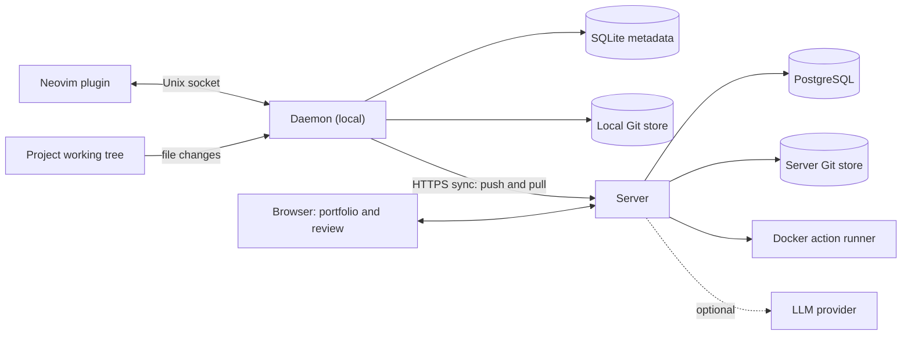

# Architecture

Cadence is an Elixir umbrella with three apps: `cadence_shared` (schemas, sync
protocol, Git object store, LLM client), `cadence_daemon` (local watcher and
socket API), and `cadence_server` (Phoenix, PostgreSQL, web UI). The Neovim
plugin in `cadence.nvim/` is a client of the daemon.

## The DAG

A **node** is an immutable snapshot: one Git commit plus metadata. It carries
`git_commit_sha`, `parents` (empty for a root, one normally, two or more for a
meld or an imported Git merge), flags from `functioning`, `in-progress`,
`broken`, and `sandbox`, and a pinned bit. There are no branches. A user's
position is a per-user, per-project **session pointer** plus an `active_heads`
set, synced so the same person resumes on another machine. A fork is a second
child of the same parent: two siblings, nothing to merge.

## The daemon

The daemon exists because history should not depend on a network or an editor.
It watches registered project directories, debounces edits into commits in a
local Git store, and keeps SQLite metadata beside it. A doc queue generates
documentation updates as a follow-up node when an LLM is configured. The
Neovim plugin talks to it over `daemon.sock`; commits, spawns, and switches
never block on the server.

## Sync

The daemon dials out; the server never connects to a working tree. Push sends
the nodes the daemon committed, parents first and idempotently by node UUID,
after an optional existence handshake that omits objects the server already
holds. Pull returns nodes newer than the server's `nodes.seq` cursor, so a
pushed node whose parent already has a child simply becomes a sibling.
Preferences use last-write-wins on `preferences_updated_at`; `pinned` is
server-authoritative and redelivered on the next pull.

A **meld** is the only way Cadence combines divergence itself, and it is
server-side: the server computes a deterministic union of 2-8 parents, calls the
model only on paths whose blob SHAs differ, and materializes the result as a
pending proposal. No node is created until a human approves, and approval
attaches the node flagged `in-progress`, never `functioning`. The one exception
is import: an owner may push an existing Git merge with its original parents,
and the meld pipeline does not run for it.

## Auth

Accounts are operator-created (`mix cadence.user`), Argon2id-hashed, with no
public registration. TOTP is mandatory for local password accounts, with ten
one-use recovery codes. Browser sessions are database rows storing only a
hashed token, with rotation, remember-me, logout revocation, and a sudo window
for credential changes. Daemons authenticate with a per-user personal access
token sent as a bearer token; the server stores only its hash. GitHub/Google
OAuth and passkeys are optional additions, not the primary path.

## See also

- [README.md](README.md): what Cadence is and how to run it.
- [DEVELOPMENT.md](DEVELOPMENT.md): toolchain and tests.
