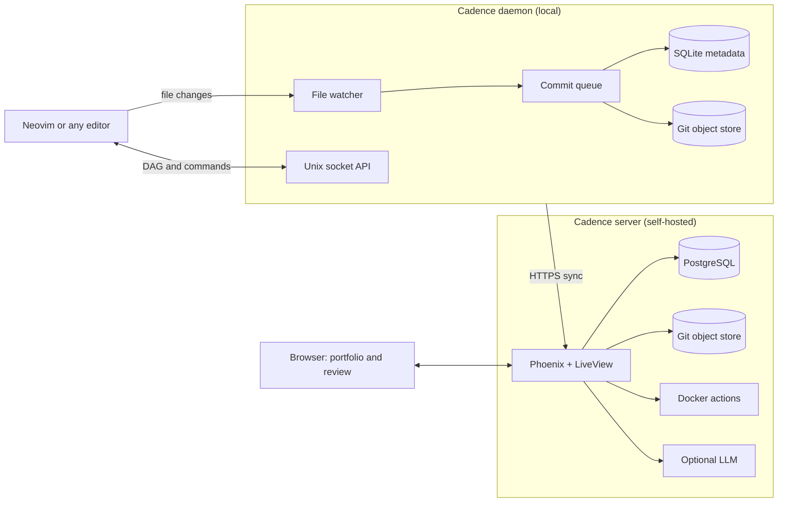

# Cadence

[](https://github.com/vyynl/cadence/actions/workflows/ci.yml)
[](LICENSE)
[](https://elixir-lang.org)

Cadence is a local-first, self-hosted source control system built around a
directed acyclic graph (DAG) of snapshots instead of Git branches.

## Why Cadence

- **No `main`, no branches.** Every snapshot is a node in a DAG. You move a
  per-user pointer to the node you are working from.
- **History writes itself.** A local daemon watches registered project
  directories and commits debounced snapshots automatically.
- **Local-first.** Commits, spawning, switching, and documentation work
  offline. Only melds (unions) need the server.
- **Review is explicit.** A meld becomes a reviewed proposal; it never
  auto-promotes a node to `functioning`.
- **Self-hosted and public-friendly.** Run the server on your own hardware and
  publish a read-only portfolio of projects and their DAGs.
- **AI assists, never decides.** Commit messages, melds, and documentation are
  generated only when configured, and always remain reviewable.

## What you can do

- **Automatic history.** Edit files in a registered project; the daemon
  snapshots the working tree, commits it, and syncs it.
- **Navigate the DAG.** Open the Neovim picker or the web view, hover a node for
  its message and diff, and switch the pointer to any snapshot.
- **Import a Git repository.** Adopt an existing local repository as a project,
  preserving commit SHAs, messages, author timestamps, merges, and tags. See
  [`docs/import.md`](docs/import.md).
- **Meld and review.** Combine divergent lines of work into a proposal, inspect
  the file-level result, and approve or reject it.
- **Publish a portfolio.** Browse projects, DAGs, rendered READMEs, and paged
  history publicly without exposing confidential paths or secrets.
- **Run Docker actions.** Define actions in `actions/manifest.json` and run them
  in sandboxed containers with captured logs and artifacts.
- **Automate documentation.** Generate documentation changes from a project
  schema, with a reviewable diff before commit.
- **Sign in securely.** Operator-created email/password accounts with mandatory
  TOTP and recovery codes; database-backed sessions with remember-me and sudo
  mode. OAuth and passkeys are optional secondary methods.

## Try it locally (demo)

```bash
docker compose up --build
```

Open <http://localhost:4000> and sign in at `/sign-in` as
`owner@demo.local` with password `cadence-demo`. The demo accounts also require
a TOTP code; print the current one with:

```bash
docker compose exec server mix cadence.totp --email owner@demo.local
```

This is a seeded, development-mode server for browsing the UI. It is **not** a
production deployment. See [`docs/demo.md`](docs/demo.md) for the guided tour.

## Run it in production

The reference stack is `docker-compose.prod.yml`: a `MIX_ENV=prod` release,
PostgreSQL, one-shot migration and first-account services, and optional bundled
Caddy TLS. The setup script generates every secret, writes `.env`, and can
start the stack.

### 1. Prerequisites

- Docker Engine 26+ and Docker Compose v2.17+.
- A DNS name that resolves to the server.
- Ports 80 and 443 open when using bundled Caddy. Nothing else needs to be
  installed on the server.
- Optional: your own TLS proxy if you choose `--tls external`.

### 2. Clone and run the setup script

```bash
git clone https://github.com/vyynl/cadence.git
cd cadence
./scripts/setup-prod.sh cadence.example.com you@example.com --up
```

The script generates `CAD_SECRET_KEY_BASE`, the database password, and the
first admin password; writes `.env` with `chmod 600`; prints the admin password
once; and starts the stack with `--up`. Add `--no-actions` if you do not want
the Docker action runner.

TLS modes:

- `--tls auto` (default): bundled Caddy obtains a Let's Encrypt certificate.
  Use a public DNS name; ports 80/443 must be reachable.
- `--tls internal`: bundled Caddy uses its local CA for a private/LAN
  hostname. The script prints how to trust the root certificate.
- `--tls external`: no Caddy; point your proxy at `127.0.0.1:4000`.

Without `--up`, start it yourself:

```bash
docker compose -f docker-compose.prod.yml --profile tls up -d --build
```

Use `--profile tls` for `auto`/`internal`; omit it for `external`. The manual
`.env` path and every reference detail are in
[`docs/deploy.md`](docs/deploy.md).

### 3. Verify

```bash
docker compose -f docker-compose.prod.yml ps
docker compose -f docker-compose.prod.yml logs migrate bootstrap
curl -fsS https://cadence.example.com/health   # {"status":"ok"}
```

With `--tls internal`, use `curl -k` or trust Caddy's CA first.

### 4. Sign in and enroll TOTP

Open `https://cadence.example.com/sign-in` with the admin email and the password
printed by the script. The first sign-in forces TOTP enrollment: scan the QR
code, confirm a code, and save the recovery codes — they are shown once.

After this succeeds, remove `CAD_ADMIN_PASSWORD` from `.env`; the bootstrap
service then becomes a no-op on later `up`s.

### 5. Connect a daemon

Create a daemon token at `/account` (or `/auth/tokens/new`), copy it once, and
follow [`docs/daemon-setup.md`](docs/daemon-setup.md) to install the daemon, run
its migration, register a project, and sync.

### 6. Operate it

```bash
# Upgrade after pulling a new release (omit --profile tls for external TLS)
git pull
docker compose -f docker-compose.prod.yml --profile tls up -d --build

# Logs
docker compose -f docker-compose.prod.yml logs -f cadence
```

- Back up the `postgres_data` and `cadence_data` volumes together; metadata and
  Git objects must stay in sync.
- Docker actions (optional) need the socket **proxy** — never mount the raw
  Docker socket. The reference stack already includes the proxy; see
  [`docs/deploy.md#docker-actions`](docs/deploy.md#docker-actions).
- Migrations are idempotent and run on every `up`. Volumes, ownership, image
  publishing, passkeys, and troubleshooting are in
  [`docs/deploy.md`](docs/deploy.md).

## Neovim

The daemon's editor front end installs from this repository — no separate
plugin checkout or build step:

```lua
{
  "vyynl/cadence",
  dependencies = { "nvim-lua/plenary.nvim" },
  config = function()
    require("cadence").setup()
  end,
}
```

Drop that in `lua/plugins/cadence.lua` for LazyVim, or use the Packer /
vim-plug / mini.deps snippets in
[`cadence.nvim/README.md`](cadence.nvim/README.md). The plugin talks to the
local daemon; see [`docs/daemon-setup.md`](docs/daemon-setup.md).

## How it works



The daemon commits locally and syncs nodes to the server. The server stores the
shared DAG, serves the public portfolio and the review UI, and runs Docker
actions. The daemon and server communicate only through the HTTP sync protocol;
there is no shared runtime and no distributed Erlang.

## Documentation

| Guide | Purpose |
|---|---|
| [`docs/demo.md`](docs/demo.md) | One-command demo stack and guided tour |
| [`docs/import.md`](docs/import.md) | Import a local Git repository |
| [`docs/daemon-setup.md`](docs/daemon-setup.md) | Install, configure, and run the daemon |
| [`docs/deploy.md`](docs/deploy.md) | Step-by-step production deployment and operations |
| [`docs/passkeys.md`](docs/passkeys.md) | Security keys and passkeys |
| [`docs/spec.md`](docs/spec.md) | Canonical product and technical contract |
| [`docs/README.md`](docs/README.md) | Full documentation index |

## Status

Cadence **1.0.0** is released. The planned build order (Phases 1–8) is complete.
Phase 9 (Git import), WebAuthn/passkeys, the local-account/TOTP/session auth
rebuild, and the turnkey self-hosting/plugin packaging are on `master` and
recorded as unreleased; see
[`docs/release-notes.md`](docs/release-notes.md) for the release summary,
upgrade notes, and known limitations.

## Development

Cadence is an Elixir umbrella with three apps (`cadence_shared`,
`cadence_daemon`, `cadence_server`) and a Neovim plugin (`cadence.nvim`). You
need Elixir 1.20, OTP 29, and Docker for the test database and demo stack.

Start with [`CONTRIBUTING.md`](CONTRIBUTING.md) for setup, the merge gate, test
conventions, and the project's hard rules.

## Security

Report vulnerabilities privately through GitHub Security Advisories. Do not open
a public issue. See [`SECURITY.md`](SECURITY.md) for the supported versions,
scope, and what to include in a report.

## License

Cadence is released under the [MIT License](LICENSE).
