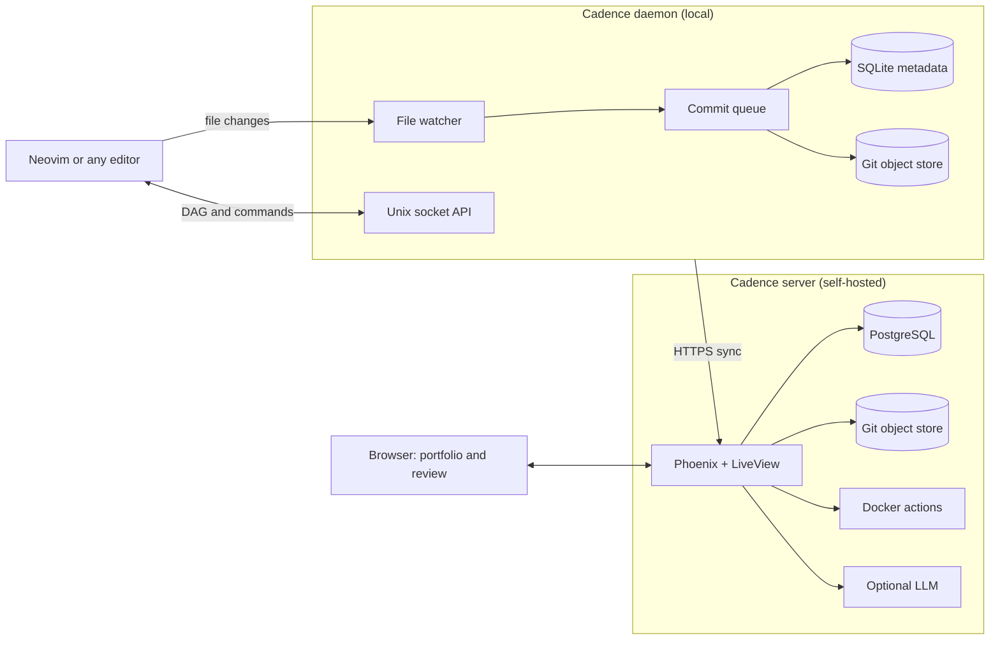

# Cadence

[](https://github.com/vyynl/cadence/actions/workflows/ci.yml)
[](LICENSE)
[](https://elixir-lang.org)

Cadence is a local-first, self-hosted source control system built around a
directed acyclic graph (DAG) of snapshots instead of Git branches.

## Why Cadence

- **No `main`, no branches.** Every snapshot is a node in a DAG. You move a
  per-user pointer to the node you are working from.
- **History writes itself.** A local daemon watches registered project
  directories and commits debounced snapshots automatically.
- **Local-first.** Commits, spawning, switching, and documentation work
  offline. Only melds (unions) need the server.
- **Review is explicit.** A meld becomes a reviewed proposal; it never
  auto-promotes a node to `functioning`.
- **Self-hosted and public-friendly.** Run the server on your own hardware and
  publish a read-only portfolio of projects and their DAGs.
- **AI assists, never decides.** Commit messages, melds, and documentation are
  generated only when configured, and always remain reviewable.

## What you can do

- **Automatic history.** Edit files in a registered project; the daemon
  snapshots the working tree, commits it, and syncs it.
- **Navigate the DAG.** Open the Neovim picker or the web view, hover a node for
  its message and diff, and switch the pointer to any snapshot.
- **Import a Git repository.** Adopt an existing local repository as a project,
  preserving commit SHAs, messages, author timestamps, merges, and tags. See
  [`docs/import.md`](docs/import.md).
- **Meld and review.** Combine divergent lines of work into a proposal, inspect
  the file-level result, and approve or reject it.
- **Publish a portfolio.** Browse projects, DAGs, rendered READMEs, and paged
  history publicly without exposing confidential paths or secrets.
- **Run Docker actions.** Define actions in `actions/manifest.json` and run them
  in sandboxed containers with captured logs and artifacts.
- **Automate documentation.** Generate documentation changes from a project
  schema, with a reviewable diff before commit.
- **Sign in securely.** Operator-created email/password accounts with mandatory
  TOTP and recovery codes; database-backed sessions with remember-me and sudo
  mode. OAuth and passkeys are optional secondary methods.

## Quick start

```bash
docker compose up --build
```

Open <http://localhost:4000> and sign in with a seeded account
(`owner@demo.local`, password `cadence-demo`). The stack is a seeded,
development-mode server; it is not a production deployment.

Then:

- [Import an existing Git repository](docs/import.md)
- [Set up the local daemon](docs/daemon-setup.md)
- [Deploy the server](docs/deploy.md)

## How it works



The daemon commits locally and syncs nodes to the server. The server stores the
shared DAG, serves the public portfolio and the review UI, and runs Docker
actions. The daemon and server communicate only through the HTTP sync protocol;
there is no shared runtime and no distributed Erlang.

## Documentation

| Guide | Purpose |
|---|---|
| [`docs/demo.md`](docs/demo.md) | One-command demo stack and guided tour |
| [`docs/import.md`](docs/import.md) | Import a local Git repository |
| [`docs/daemon-setup.md`](docs/daemon-setup.md) | Install, configure, and run the daemon |
| [`docs/deploy.md`](docs/deploy.md) | Production server deployment |
| [`docs/passkeys.md`](docs/passkeys.md) | Security keys and passkeys |
| [`docs/spec.md`](docs/spec.md) | Canonical product and technical contract |
| [`docs/README.md`](docs/README.md) | Full documentation index |

## Status

Cadence **1.0.0** is released. The planned build order (Phases 1–8) is complete.
Phase 9 (Git import), WebAuthn/passkeys, and the local-account/TOTP/session
auth rebuild are on `master` and recorded as unreleased; see
[`docs/release-notes.md`](docs/release-notes.md) for the release summary,
upgrade notes, and known limitations.

## Development

Cadence is an Elixir umbrella with three apps (`cadence_shared`,
`cadence_daemon`, `cadence_server`) and a Neovim plugin (`cadence.nvim`). You
need Elixir 1.20, OTP 29, and Docker for the test database and demo stack.

Start with [`CONTRIBUTING.md`](CONTRIBUTING.md) for setup, the merge gate, test
conventions, and the project's hard rules.

## Security

Report vulnerabilities privately through GitHub Security Advisories. Do not open
a public issue. See [`SECURITY.md`](SECURITY.md) for the supported versions,
scope, and what to include in a report.

## License

Cadence is released under the [MIT License](LICENSE).
