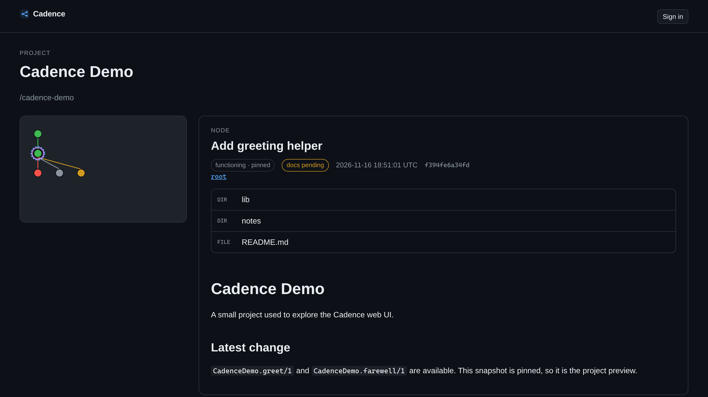
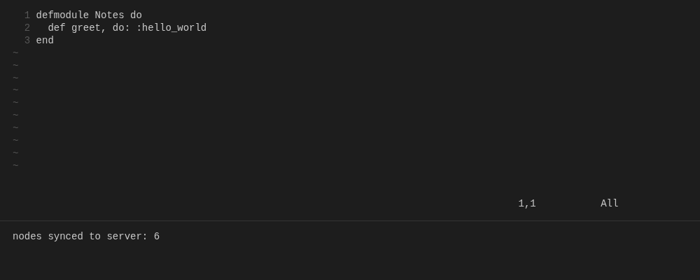

# Cadence

Cadence is a local-first, self-hosted source control system. Its history is a
DAG of immutable snapshots — one node per commit, no branches — and each user
moves their own pointer through it.

[](https://github.com/vyynl/cadence/actions/workflows/ci.yml)
[](https://github.com/vyynl/cadence/actions/workflows/demo-smoke.yml)
[](https://github.com/vyynl/cadence/pkgs/container/cadence)
[](LICENSE)

## Why Cadence

- **The DAG replaces branches.** Every snapshot is a node with parents, and
  your session pointer is yours alone. A divergent line is a sibling node, so
  there is no branch to merge and no merge conflict on the DAG itself.
- **Offline-first.** A local daemon watches your project directory, commits
  debounced snapshots to a local Git store, and syncs when the server is
  reachable. Commits, spawns, and switches work with no network.
- **Editor-native.** The Neovim picker renders the DAG and switches, spawns, or
  submits a meld without leaving the editor, over the daemon's Unix socket.

## Run the server

No clone. These two files are the whole stack — keep them as your base:

```bash
curl -fsSLO https://raw.githubusercontent.com/vyynl/cadence/master/docker-compose.yml
curl -fsSLO https://raw.githubusercontent.com/vyynl/cadence/master/.env.example
mv .env.example .env     # set CAD_PUBLIC_URL and CAD_ADMIN_EMAIL
docker compose up -d
docker compose logs secrets     # first-admin password, printed once
```

Open the URL and sign in with `CAD_ADMIN_EMAIL` and that password. If the GHCR
package is private, `docker login ghcr.io` first (token with `read:packages`).
Add `--profile tls` for bundled Caddy. [DEPLOY.md](DEPLOY.md) covers layouts,
backups, and upgrades.

## Run the daemon

Mint a token at `/auth/tokens/new` on the server, then:

```bash
token=cad_paste_the_token_here
STATE="$HOME/.local/state/cadence"
docker run -d --name cadence-daemon --restart unless-stopped \
  --user "$(id -u):$(id -g)" --network cadence-prod_default \
  -v "$STATE:$STATE" -e CAD_STATE_DIR="$STATE" \
  -v /path/to/project:/path/to/project \
  -e CAD_SERVER_URL=http://cadence:4000 -e CAD_AUTH_TOKEN="$token" \
  --entrypoint /bin/sh ghcr.io/vyynl/cadence-daemon:latest \
  -c 'bin/cadence_daemon eval "Cadence.Daemon.Release.migrate()" && exec bin/cadence_daemon start'

docker exec cadence-daemon bin/cadence_daemon eval \
  'IO.inspect(Cadence.Daemon.Release.register("My Project", "my-project", "/path/to/project"))'
```

Edit a file in that directory and the project appears at `/p/my-project` within
about 20 seconds. `:CadOpen` in Neovim reads the same DAG: the socket is at
`~/.local/state/cadence/daemon.sock`, where the plugin looks by default.

Remote server instead of a local one? Drop `--network` and set `CAD_SERVER_URL`
to its public origin. Mount project directories at their **real** paths, and
give each project a second `-v` line.

## Demo

`docker compose -f docker-compose.demo.yml up --build` starts a seeded server on <http://localhost:4000>; the tour is [DEMO.md](DEMO.md).

## Screenshots





## Docs

| Document | Contents |
|---|---|
| [DEPLOY.md](DEPLOY.md) | Production stack, layouts, backup and restore, upgrades |
| [DAEMON.md](DAEMON.md) | Installing, configuring, and registering projects with the daemon |
| [DEMO.md](DEMO.md) | The seeded demo stack and guided tour |
| [ARCHITECTURE.md](ARCHITECTURE.md) | The DAG model, the daemon, sync, and auth |
| [DEVELOPMENT.md](DEVELOPMENT.md) | Toolchain, tests, and running the pieces locally |
| [TROUBLESHOOTING.md](TROUBLESHOOTING.md) | Symptom, cause, and fix for common failures |
| [CHANGELOG.md](CHANGELOG.md) | Releases and known limitations |
| [SECURITY.md](SECURITY.md) | Supported versions and private vulnerability reporting |

Adopting an existing Git repository is one command: `mix cad.import ~/code/thing`, from a source checkout with the daemon running.

## Contributing

Fork the repository and work on a branch. Run `mix test` from the umbrella root
before opening a pull request; [DEVELOPMENT.md](DEVELOPMENT.md) has the full
gate and the test database. Security reports follow [SECURITY.md](SECURITY.md)
and never go in a public issue.

## See also

- [DEPLOY.md](DEPLOY.md) — run the server.
- [ARCHITECTURE.md](ARCHITECTURE.md) — how the pieces fit together.
